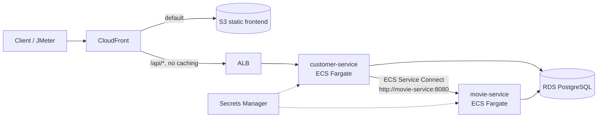
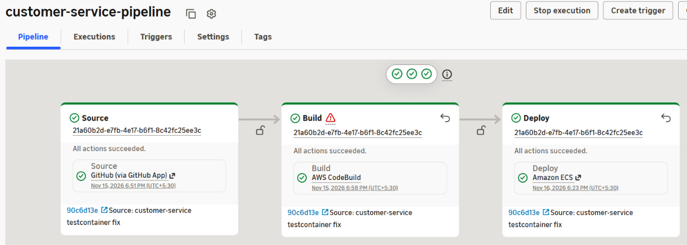
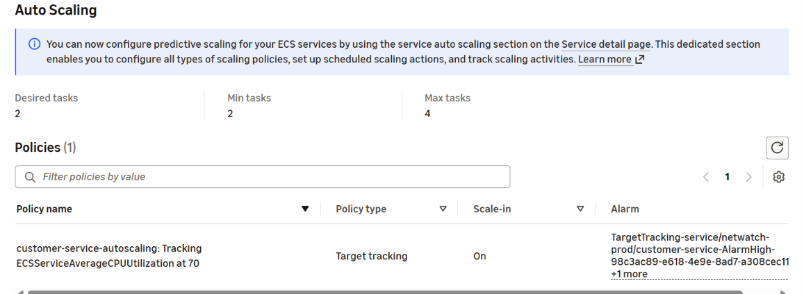
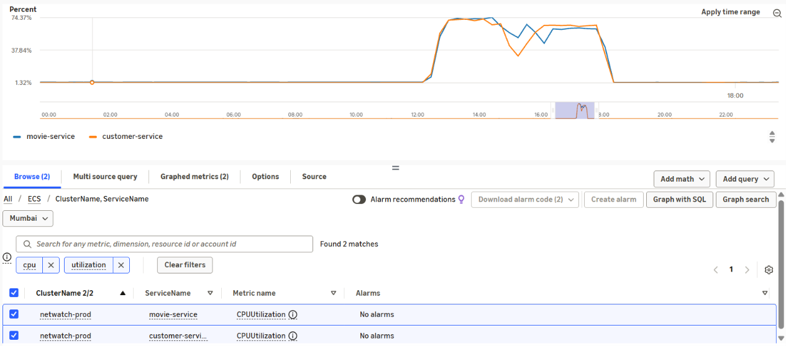
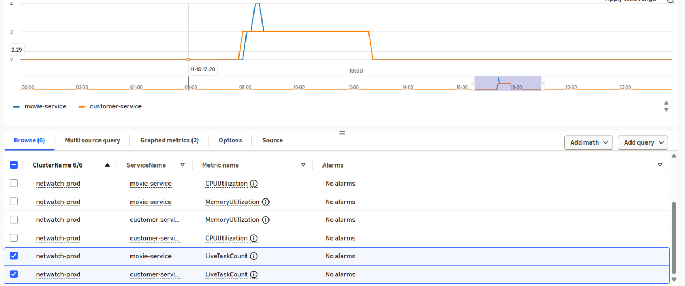
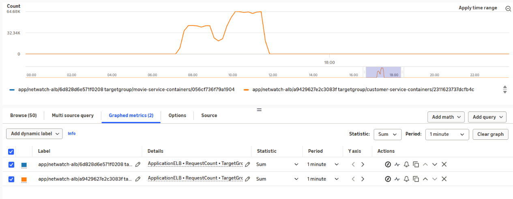
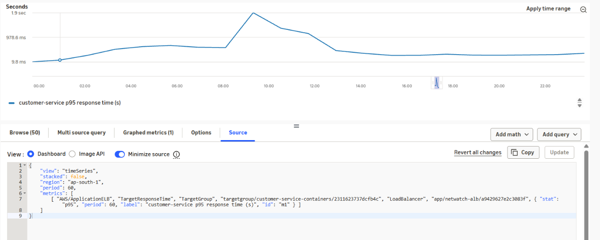

# customer-service

A Spring Boot service that returns a customer's profile together with movie recommendations for their favorite genre. The recommendations come from [movie-service](https://github.com/sadiq1aziz/movie-service), which customer-service calls over ECS Service Connect. Both services run on AWS ECS Fargate behind CloudFront and an ALB, ship through a CodePipeline CI/CD pipeline, and scale on CPU.

The project takes a pair of Spring Boot services through a full cloud delivery cycle: containerize, deploy through CI/CD, scale under load, and measure the result.

## Results at a glance

- Two services on ECS Fargate (two AZs, private subnets) behind CloudFront and an ALB, with commit-SHA image tags, rolling deploys with circuit-breaker rollback, database credentials from Secrets Manager, and Service Connect networking between services.
- JMeter load tests at 200 concurrent users: about 2 million requests across two 20-minute runs, about 1,060 requests per second at steady state, no 5xx responses.
- CPU target-tracking autoscaling (70% target, 2 to 4 tasks) took each service from 2 to 3 tasks under load, lifting throughput from about 705 to about 1,059 req/s and cutting client-side p95 latency from about 711 ms to about 393 ms.
- ECS events and CloudWatch alarm history showed why one scale-out took longer than expected: the new task missed its health-check grace period and was replaced.

## Architecture

Everything runs in `ap-south-1` on the `netwatch-prod` cluster. Each task has 0.5 vCPU and 1 GB of memory, and both services use one RDS PostgreSQL instance. CloudFront serves a static frontend from S3 and forwards `/api/*` to the ALB with caching disabled, so API requests always reach the tasks.

## API

| Method | Path | Description |
|---|---|---|
| GET | `/api/customers/customer/{id}` | Customer plus movie recommendations (404 if not found) |
| PATCH | `/api/customers/{id}/genre` | Update the favorite genre. Body: `{"favoriteGenre": "COMEDY"}` |
| GET | `/actuator/health` | Health check used by the ALB |

## Stack and local run

Java 21, Spring Boot 4, Spring Data JPA, PostgreSQL, Spring `RestClient`, Actuator, Spring Cloud AWS (Secrets Manager), Maven, Docker, Testcontainers.

To run it locally, create the schema from `src/main/resources/db-init.sql`, start movie-service (port 7070), then run `./mvnw spring-boot:run` and call `http://localhost:8080/api/customers/customer/1`. `./mvnw test` runs the integration tests against a throwaway PostgreSQL container, so Docker needs to be running. In AWS the task runs with `SPRING_PROFILES_ACTIVE=prod` and reads its database credentials from Secrets Manager, so nothing sensitive is baked into the image.

## Deployment

The CodePipeline has three stages: Source (GitHub, branch `main`), Build (CodeBuild) and Deploy (ECS). The build runs `mvn clean package` including the Testcontainers integration tests, builds the Docker image, tags it with the commit SHA, pushes it to ECR and emits `imagedefinitions.json`. Deploys are rolling, with the ECS deployment circuit breaker rolling back a bad release automatically, and the Deploy stage is also set to roll back on failure. A build takes about 93 seconds and a deploy about 63 seconds.

## Autoscaling

Both services scale on average CPU with a target-tracking policy.

| Setting | Value |
|---|---|
| Target | 70% average CPU |
| Task range | 2 to 4 |
| Scale-out alarm | average CPU above 70% for 3 consecutive 1-minute periods |
| Scale-in alarm | average CPU below 63% for 15 consecutive 1-minute periods |
| Cooldowns | 300 s out, 300 s in |
| Health check | `/actuator/health`, 30 s interval, 5 s timeout, 90 s grace period |

## Load testing

JMeter ran 200 virtual users sending requests back to back for 20 minutes (ramped up over the first 200 seconds) against `GET /api/customers/customer/1` through CloudFront. Each request goes through the ALB to customer-service and on to movie-service, so both services are exercised. The run on 19 Nov 2026 covered about 930,000 requests with no 5xx responses (and 2 client-side TLS handshake errors). An earlier run on 17 Nov with the same plan gave consistent results: 1.06 million requests at about 1,060 to 1,117 req/s steady state, with no errors.

### Saturation, scale-out, recovery

Both services started the 19 Nov run at 2 tasks. At 200 users that fleet saturated: CPU passed the 70% target and the autoscaling alarms added a third task to each service. The same run, before and after:

| | 2 tasks each (saturated) | 3 tasks each (after scale-out) |
|---|---|---|
| Average CPU per service | about 72%, above the 70% target | about 61-65% |
| Requests per minute at the ALB | about 42k | about 62-65k |
| Throughput | 705 req/s | 1,059 req/s |
| Client latency: avg / p95 / p99 | 284 / 711 / 1,009 ms | 189 / 393 / 557 ms |
| Server-side p95 (ALB) | 0.51-0.66 s | 0.27-0.31 s |

Windows: 17:29-17:33 (before) and 17:38-17:45 (after); CPU averaged over 17:27-17:31 and 17:38-17:44.

### How the scale-out played out

CPU crossed the 70% target at 17:27, and the scale-out alarms fired at 17:32 because they require three consecutive minutes above target. customer-service had its third task serving by 17:33. movie-service's first new task missed its 90-second health-check grace period and was replaced, so its third task was serving by 17:36. Latency rose briefly while the new tasks came into service, then settled at the lower levels above. The database and memory had plenty of headroom (RDS CPU peaked at 32%, per-task memory at about 55%). About 17 minutes after the load ended, both services scaled back to 2 tasks.

### Screenshots (19 Nov, about 17:15 to 18:05 IST, 1-minute periods)

*Average CPU of both services passes the 70% target at 17:27 as the two-task fleet saturates, drops to about 61-65% once the third tasks join, and returns to idle after the load ends at 17:45.*

*Running tasks: each service goes from 2 to 3 as the CPU alarms fire (customer-service at 17:32, movie-service by 17:36, briefly showing 4 while its first new task is replaced), then back to 2 at about 18:03.*

*ALB requests per minute: about 42k while saturated, about 62-65k after scale-out. The dip at 17:33-17:35 is the hand-over to the new tasks.*

*customer-service p95 response time: about 0.5-0.66 s while saturated, a short peak at 17:33 during the hand-over, and about 0.27-0.31 s after scale-out.*

## Next steps

Terraform for the infrastructure, and resilience controls (timeouts and a circuit breaker) around the call to movie-service.
